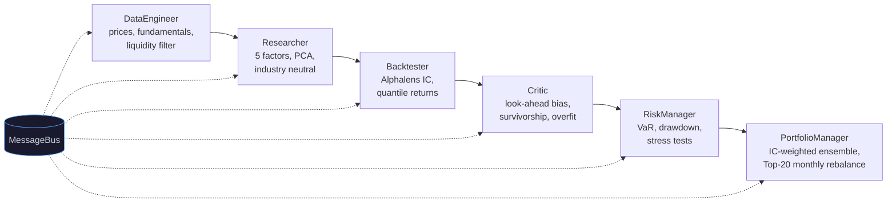

# Quant Research Hub

An agent-structured research pipeline for US equity factor research and portfolio construction. Six deterministic, role-based stages run sequentially through a shared message bus, each with a defined input and output contract. This is a research prototype, not an autonomous trading system.

**Live research showcase:** [Quant Research Pipeline](https://wenyu0608.github.io/macro-risk-dashboard/#pipeline) · [Alpha Deck](https://wenyu0608.github.io/macro-risk-dashboard/#factorlab)

## Architecture



All stages communicate through a `MessageBus` (shared state store with pub/sub). The Orchestrator runs them sequentially and handles failure/reject logic.

## Key Results

Canonical, sample-specific results on an effective 459-instrument Russell panel, 2022-04 to 2024-12, Top-20 equal-weight monthly rebalance, 10bps/side transaction cost:

| Model | Sharpe | Ann. Return (net) | Max Drawdown | Total Cost |
|---|---|---|---|---|
| **IC-weighted linear** | **0.56** | **12.1%** | **-21.5%** | 4.6% |
| LightGBM LambdaRank | 0.44 | 13.7% | -26.9% | 6.2% |
| LightGBM Regression | 0.17 | 5.2% | -38.0% | 6.6% |

Qlib cross-check: the locked SP500 portfolio-construction baseline was reproduced within 0.02 percentage points (2 bp) in net annual return. This validates that baseline implementation only; it does not independently validate the Russell model scores or all LightGBM findings.

## Design Decisions

**Why role-based stages.** Each stage has a single responsibility and a well-defined contract (input keys and output keys on the MessageBus). The Critic applies deterministic research checks, while the RiskManager records drawdown, VaR and stress tests. The separation makes assumptions and failures easier to audit.

**Why IC-weighted linear beats LightGBM OOS.** The checked-in fold schedule contains 23 rolling 24M-train/3M-test windows; the quoted backtest covers the 2022-04 to 2024-12 evaluation period. In this sample, simple IC-weighting has the best risk-adjusted result. This is evidence for this evaluation period, not stable alpha.

**PCA quarantine.** PCA is valid only when fit within each walk-forward training fold. Full-sample PCA is excluded from externally quoted performance and retained only as an audit lesson. The generic pipeline therefore uses raw factors by default.

## Factors

| Factor | Definition | Rationale |
|---|---|---|
| Momentum (ret_2_12) | Cumulative 2-12M return, skip recent 1M | Price trend continuation |
| Value (B/P) | Book value / price, 2M lag | Mean reversion to fundamentals |
| Size (log mcap) | log(market cap), 2M lag | Small-cap premium |
| Low Volatility | -20D rolling std of returns | Low-risk anomaly |
| Reversal | -1M return | Short-term mean reversion |

Fundamental factors use a two-month lag as a reporting-delay proxy. The source is still a current fundamental snapshot rather than a genuine point-in-time database, so residual look-ahead and survivorship risk remains.

The sole external-claim manifest and limitations are in [`research/canonical_results.json`](research/canonical_results.json). No result represents live capital, real-money performance or validated stable alpha.

## Research Discipline

Three preregistered factor cases (F001-F003) completed the S0-S7 protocol and were retained as null results. The [audit review](factor_pipeline/DEAD_REVIEW.md) also records the UVIX reverse-split handling error, the corrected benchmark, and why the failed conclusions did not change. The Qlib reproduction within 0.02 percentage points (2 bp) in net annual return applies only to the locked SP500 portfolio-construction baseline.

## Project Structure

```
agents/               # Multi-agent equity factor pipeline
factor_pipeline/       # Manual factor research protocol (S0–S7) + case files
    PIPELINE.md       # Shared checklist / pitfalls per stage
    README.md         # How to open a new factor case
    cases/            # e.g. F001 UVIX event calendar
dashboard/            # Macro risk + Alpha Deck (#factorlab) research hub
run.py                # Entry point (pipeline + optional Flask dashboard)
qlib_migration/       # Walk-forward LightGBM experiments, Qlib cross-validation
```

## Quick Start

```bash
git clone https://github.com/wenyu0608/macro-risk-dashboard.git && cd macro-risk-dashboard
python -m venv .venv && source .venv/bin/activate
pip install -r requirements.txt

# Run full pipeline (downloads data, computes factors, backtests)
python run.py --no-frontend

# Run with live dashboard
python run.py
# Open http://localhost:8765
```

## Tech Stack

Python, yfinance, alphalens-reloaded, scikit-learn (PCA), pandas, numpy, matplotlib, Flask. LightGBM and Microsoft Qlib for the ablation study.
